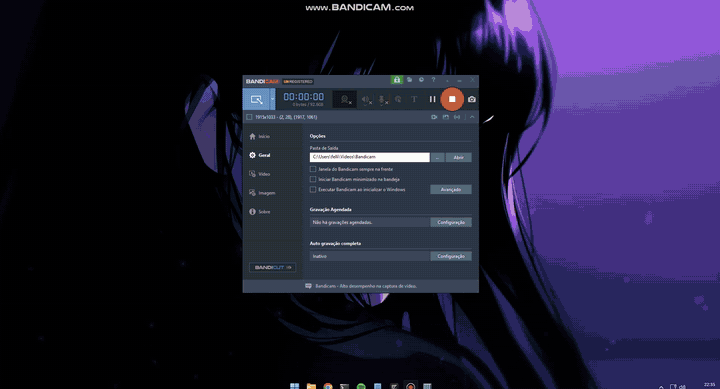

# OTClient com RmlUi

[English](README.md) | **Português (Brasil)**

OTClient com **[RmlUi 6.3](https://github.com/mikke89/RmlUi)** integrado: telas feitas em
**HTML (.rml) e CSS (.rcss)**, com data binding em Lua, convivendo com as janelas OTUI de sempre.
A API segue a do cliente do Ninja World Online (`g_rml`, `UIRmlWidget`, `RmlWindow`).

> [!WARNING]
> **Não dou suporte.** O projeto é disponibilizado como está: issues, dúvidas e
> pedidos de ajuda não serão respondidos. Use, faça fork e adapte por sua conta.

[](docs/images/rmlui/showcase.mp4)

[Vídeo completo (MP4)](docs/images/rmlui/showcase.mp4)

## O que foi adicionado

- `UIRmlWidget` / `RmlWindow` / `RmlWidget`: um documento RmlUi dentro da árvore OTUI
  (`rml-source:` no .otui ou `widget:loadDocument()` no Lua), com mouse, teclado, foco,
  arrastar pela barra (`data-drag="window"`) e debugger visual do RmlUi.
- `g_rml`: inicialização, fontes (`data/fonts/rml`), conversão Latin-1/UTF-8, lista de widgets.
- Imagens do jogo direto no HTML: `item/<id>.png`, `effect/<id>.png`,
  `outfit/<looktype>-<cores>-<addons>-<direção>.png`, com ampliação sem borrar (`@2x`..`@8x`).
- Efeitos completos do RmlUi 6 com OpenGL 3.3 (gradientes, sombras, filtros, máscaras,
  animações e transições) e o tema `efeitos` para versões leve/completa do CSS.
- Widgets OTUI nativos dentro do RML (minimapa, item, criatura) com `Rml.host`.
- Helpers Lua documentados em [`modules/corelib/rml.lua`](modules/corelib/rml.lua), com a
  equivalência OTUI → RmlUi.
- `.dat/.spr` exportados pelo Object Builder: o `Tibia.otfi` ao lado é respeitado.

## Exemplos

| Módulo | Atalho | Conteúdo |
|---|---|---|
| `client_rmlshowcase` | botão **RmlUi** no topo / **Ctrl+Shift+U** | abas: data binding, formulários, sprites, OTUI no RML (minimapa), imagens e carrossel, efeitos, OTUI para RmlUi, Lua e DOM |
| `client_rmloptions` | **Ctrl+Shift+O** | opções do cliente em RmlUi |
| `game_rmloutfit` | **Ctrl+Shift+F** | outfit com preview, cores, addons e looktypes |
| `game_rmlminimap` | **Ctrl+Shift+M** | minimapa com controles em RML |
| `client_rmldemo` | **Ctrl+Shift+R** | exemplo mínimo |

Para ver sprites e minimapa fora do jogo, coloque os arquivos do jogo em
`data/things/<versão>/` (`Tibia.dat`, `Tibia.spr`, `Tibia.otfi` e, se tiver, `minimap.otmm`) e use
o botão **Carregar assets** do showcase.

## Uso rápido

```lua
local window, model = Rml.createWindow{
    document = '/modules/meu_modulo/janela.rml',
    model = 'meu',
    data = {
        count = 0,
        Add = function(event, delta) model.count = model.count + delta end,
    },
}
```

```html
<rml>
<head><link type="text/rcss" href="/styles/rml/otc.rcss"/></head>
<body>
  <div class="otc-window" data-model="meu">
    <header class="otc-header" data-drag="window"><span class="otc-title">Minha janela</span></header>
    <p>Cliques: {{count}}</p>
    <button class="btn primary" data-event-click="Add(1)">+1</button>
    
  </div>
</body>
</rml>
```

Documentação completa (API, recursos do RML, arquitetura): [docs/RMLUI.md](docs/RMLUI.md).

## Compilando

Windows com Visual Studio 18 (MSVC v145) e [vcpkg](https://github.com/microsoft/vcpkg)
(`VCPKG_ROOT`, padrão `C:\vcpkg`):

```bat
build-rml.bat          :: configura e compila
build-rml.bat build    :: só compila
```

O CMake baixa o RmlUi 6.3 e o compila com o plugin Lua sobre o LuaJIT do cliente.
`-DTOGGLE_RMLUI=OFF` desliga a integração.

## Créditos

Baseado no **OTClient - Redemption** de mehah: <https://github.com/mehah/otclient>
(derivado do [OTClient](https://github.com/edubart/otclient) original de edubart).
O README, a documentação e o roadmap do projeto base estão no repositório dele.

- [RmlUi](https://github.com/mikke89/RmlUi) — MIT ([src/framework/rml/RMLUI_LICENSE.txt](src/framework/rml/RMLUI_LICENSE.txt))
- Fontes [Barlow](https://github.com/jpt/barlow) e [Share Tech Mono](https://fonts.google.com/specimen/Share+Tech+Mono) — SIL Open Font License (`data/fonts/rml`)

Licença MIT, veja [LICENSE](LICENSE).
